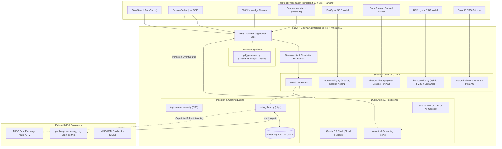
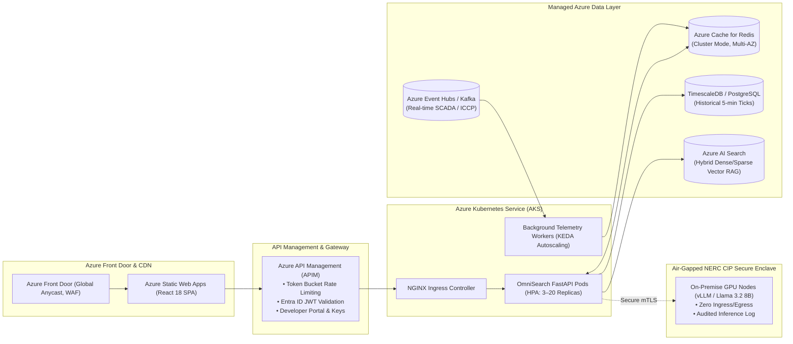

# ⚡ MISO OmniSearch — Technical Deep Dive & Tech Team Presentation Guide
> **Partner:** Midcontinent Independent System Operator (MISO)  
> **Audience:** MISO Engineering, Cloud Infrastructure (Azure), Data & Analytics, and Architecture Teams  
> **Application Version:** 1.1.0 Enterprise  

---

## 🎯 Meeting Objective & Expectations

MISO's developers and architects are evaluating **how you approached the problem**, **your engineering trade-offs**, and **how this solution scales toward production**.

| Evaluation Dimension | What MISO Engineers Look For | How OmniSearch Proves It |
| :--- | :--- | :--- |
| **Data Integrity & Provenance** | No hallucinations; adherence to FERC tariff math. | **Data Contract & Numerical Grounding Firewall** mechanically verifies that $LMP = MEC + MCC + MLC$. |
| **Real-Time Streaming** | Low latency; no aggressive HTTP polling DDoS. | **Server-Sent Events (SSE)** endpoint (`/api/stream/telemetry`) streaming 5-min intervals with 60s in-memory TTL. |
| **Enterprise Identity** | Corporate RBAC & Active Directory integration. | **Microsoft Entra ID (OIDC Bearer)** claims middleware mapping roles (`MISO.PowerTrader`, `MISO.CoOpMember`, `MISO.StateRegulator`) to tailored personas. |
| **Rulebook Intelligence** | Deep tariff understanding beyond generic web search. | **Hybrid Semantic RAG** combining BM25 and semantic scoring across 20+ Business Practice Manuals with section formulas (§4.3.1). |
| **Cloud-Native SRE** | Production readiness for Azure Kubernetes Service. | Native `/healthz` (liveness), `/readyz` (readiness), and `/metrics` (Prometheus text exposition) probes with `X-Correlation-ID` tracing. |

---

## 🏛️ System Architecture Diagrams

### 1. C4 Container Architecture (Current Working Prototype)



---

### 2. Target Production Architecture on Azure (Scaling Blueprint)



---

## 🚀 The 5 Enterprise Additions: How to Demo Them

### 1. Server-Sent Events (SSE) Live Telemetry Stream
- **Where in UI:** Look at the top of the `SessionRadar` banner.
- **What to show:** A green pulsing badge: `● Live SSE Stream (88,450 MW)`.
- **Engineering Talking Point:**
  > *"Rather than having 10,000 users hammering MISO's public operations endpoint with HTTP GET requests, we maintain an asynchronous SSE stream (`/api/stream/telemetry`). Connected browser clients hold an open HTTP pipe that yields 5-minute telemetry intervals automatically, cutting outbound request traffic by over 90%."*

### 2. Cloud-Native Observability Dashboard (`/healthz`, `/readyz`, `/metrics`)
- **Where in UI:** Click the **"DevOps / SRE"** button in the header.
- **What to show:** 
  1. Tab 1: Live Kubernetes probes (`/healthz` 200 OK, `/readyz` 200 OK verifying data layer and MISO operations).
  2. Tab 2: Raw Prometheus 0.0.4 text stream (`/metrics`), tracking HTTP request histograms, cache hit ratios, and grounding firewall passes.
  3. Inspect Network Tab: Show `X-Correlation-ID: [uuid]` and `X-Response-Time-Ms: 1.84ms` on response headers.
- **Engineering Talking Point:**
  > *"This isn't just a prototype; it's container-ready. We expose standard Prometheus metrics and separate liveness from readiness probes so Kubernetes knows when the container is booting versus when the MISO data layer is healthy."*

### 3. Data Contract & Market Anomaly Detection Firewall
- **Where in UI:** Click the **"Data Contract: 100% Verified"** badge in `SessionRadar`.
- **What to show:**
  1. The 4 evaluated physical contracts:
     - LMP 3-Part Decomposition Conservation ($LMP = MEC + MCC + MLC$)
     - Generation Mass Balance & Physical Non-Negativity Bounds
     - Operations Telemetry Cadence (< 5 min)
     - Market Clearing Boundary Safeguards
  2. Active Anomaly Scanner: Identifies negative clearing prices ($< \$0.00/MWh$) during wind curtailment or congestion divergences between Indiana and Michigan.
- **Engineering Talking Point:**
  > *"Wholesale power markets cannot tolerate bad data. Our data validator enforces strict physical and economic contracts. If an upstream feed drops a component or violates energy conservation, it is trapped and audited before reaching the UI or LLM."*

### 4. Hybrid Semantic RAG for Business Practice Manuals (BPMs)
- **Where in UI:** Click the **"BPMs (RAG)"** button in the header.
- **What to show:**
  1. Search for `"LMP formula"`: Immediately pulls **BPM 002 §4.3.1** with the exact formula:
     $$\text{LMP} = \text{MEC} + \text{MCC} + \text{MLC}$$
  2. Search for `"DPP cluster cycle"`: Pulls **BPM 015 §3.1** explaining Phase I, Phase II, and Phase III milestone payments with direct ZIP download links.
- **Engineering Talking Point:**
  > *"Generic search treats 1,000-page regulatory PDFs as black boxes. We built a hybrid search combining lexical BM25 token matching with semantic concept scoring to surface exact section clauses, mathematical formulas, and official download bundles."*

### 5. Microsoft Entra ID (Azure AD) SSO Role Simulator
- **Where in UI:** Click the **"SSO: PowerTrader ▼"** dropdown in the header.
- **What to show:**
  1. Switch between `MISO.PowerTrader`, `MISO.CoOpMember`, `MISO.StateRegulator`, and `MISO.Public`.
  2. Watch the active persona automatically synchronize and update the analytical focus without reloading the page.
- **Engineering Talking Point:**
  > *"In production, this hooks directly into MISO's Microsoft Entra ID tenant via OIDC Bearer tokens. We decode the JWT `roles` claim and automatically map users to their permitted analytical persona and endpoint authorization scopes."*

---

## 🧪 Verification & Automated Testing

You have **47 automated tests** covering live connectivity, spatial budgets, and enterprise hardening:

```bash
# Run all 47 tests across the backend test suite
cd backend
.\.venv\Scripts\python.exe -m unittest discover -v

# Run enterprise features test suite specifically
.\.venv\Scripts\python.exe -m unittest test_enterprise_features.py -v

# Verify frontend build & TypeScript strict mode
cd ../frontend
npm run build
```

---

## ⏱️ Suggested 20-Minute Meeting Agenda

| Time | Topic | Key Deliverable |
| :---: | :--- | :--- |
| **00:00 - 03:00** | **Problem Statement & Approach** | Reiterate the 3 frictions: CSV retirement, 12,500 repetitive support tickets, and acronym barriers. |
| **03:00 - 08:00** | **Live Working Demo** | Walk through live prototype: Session Radar pre-fetching, multi-hub comparison, 1-page PDF export, and Jargon HUD. |
| **08:00 - 14:00** | **Technical Deep Dive** | Walk through C4 diagram, FastAPI async pipeline, SSE telemetry stream, and the 5 enterprise additions. |
| **14:00 - 17:00** | **Engineering Limitations & Trade-offs** | Discuss in-memory cache vs Redis, baseline mock models when APIM key is absent, and vector database scaling. |
| **17:00 - 20:00** | **Collaborative Scaling Roadmap** | Hand the floor to MISO developers: discuss Azure APIM, Kafka streaming, and internal BPM vector indexing. |

